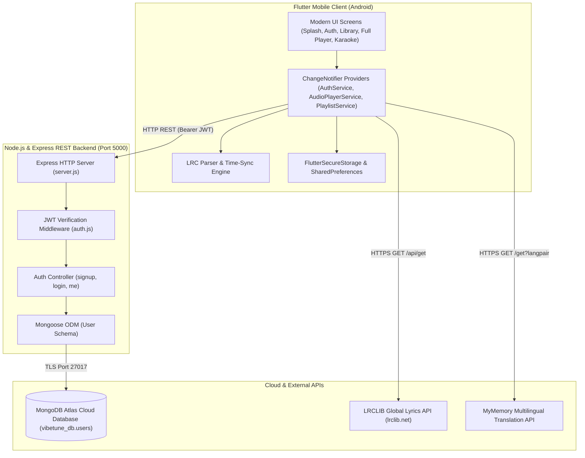

# VibeTune — MCA Final Year Project Report & Comprehensive Viva Voce Guide

---

## 1. Project Abstract
**VibeTune** is a professional, full-stack cross-platform music streaming and sing-along application built for modern music enthusiasts. Developed using the **Flutter** mobile framework (Dart) for Android and an **Express/Node.js** RESTful backend paired with cloud-hosted **MongoDB Atlas**, VibeTune features real-time **synchronized lyrics (LRC)**, dynamic **multilingual lyric translation** across major Indian film languages (Hindi, Kannada, Telugu, Tamil, Malayalam, and English), and an interactive **Karaoke Sing-Along Mode** with instrumental backing track toggle, stage lighting simulation, and pitch/speed controls.

Unlike conventional music players that merely display static text blocks, VibeTune synchronizes timestamped lines with millisecond audio playback accuracy, fetches real-time crowdsourced lyrics via the **LRCLIB API**, and enables users to enjoy music across regional language boundaries with on-the-fly line-by-line translation that strictly preserves rhythmic timestamps.

---

## 2. Problem Statement
Contemporary digital streaming services offer vast audio catalogues but present significant UX and accessibility shortcomings for regional audiences and sing-along enthusiasts:
1. **Unsynchronized or Missing Regional Lyrics**: Most popular platforms either lack lyrics for regional Indian film music or present them as static, unformatted wall-of-text blocks that do not follow playback position.
2. **Language Barriers in Multilingual Societies**: Listeners who enjoy melodies across regional languages (e.g., a Kannada speaker enjoying a Malayalam melody or a Hindi speaker listening to Telugu cinema tracks) cannot understand the lyrical meaning without external translation tools.
3. **Absence of Dedicated Karaoke & Instrumental Modes**: Enthusiasts and vocalists who wish to practice singing have to switch to separate software or rely on unofficial, low-quality video streams to find backing tracks with synchronized prompts.
4. **Data Security & Session Vulnerabilities**: Many student-level music players rely on insecure mock storage or hardcode API keys and plain-text passwords directly on the mobile client.

---

## 3. Project Objectives
1. **Secure User Authentication**: Build a production-grade registration and login subsystem using salt-hashed passwords (**bcryptjs**) and stateless JSON Web Tokens (**JWT**) with client-side secure hardware storage.
2. **Cloud Database Persistence**: Maintain user profiles, preferences, and session histories on **MongoDB Atlas** (`vibetune_db`) with Mongoose schema validation.
3. **Synchronized Lyric Engine**: Design an efficient LRC parsing algorithm that tracks playback position with active line detection and automatic smooth scrolling.
4. **Multilingual Translation Layer**: Enable on-demand translation across 6 languages while strictly maintaining original time-tags for continuous synchronization.
5. **Interactive Karaoke Experience**: Integrate dedicated instrumental audio channels, adjustable playback tempo, and a full-screen high-contrast lyrical interface.
6. **Curated Indian Music Library**: Provide a catalogue of 50+ verified audio tracks covering Bollywood, Sandalwood, Tollywood, Kollywood, and Mollywood genres with genuine metadata.

---

## 4. Existing System vs. Proposed System

| Feature / Dimension | Existing Typical Systems | VibeTune Proposed System |
| :--- | :--- | :--- |
| **Frontend Framework** | Web HTML/JS or Basic Native Android | Flutter 3.x (Declarative, Reactive UI with Material 3 styling) |
| **Backend & Architecture** | Static files or monolithic local DB | Express.js REST API + MongoDB Atlas cloud cluster |
| **Authentication** | Plaintext local storage / mock credentials | Salted bcryptjs (10 rounds) + Cryptographic Bearer JWTs |
| **Lyrics Display** | Static unsynchronized text | Real-time LRC synchronized scrolling with millisecond highlights |
| **Multilingual Lyrics** | Single fixed language | On-the-fly multilingual translation with preserved time-tags |
| **Karaoke Capability** | None or external third-party links | Native toggle between vocal and instrumental backing tracks |
| **Offline Resilience** | App crashes without network | Cached sessions, offline asset fallbacks, and local catalog |

---

## 5. System Architecture



---

## 6. Module Descriptions

### Module 1: Professional Application UI
- Custom Dark-Themed aesthetic using deep purples (`#18002E`), neon amethysts (`#9C27B0`), and vibrant teals (`#00E5FF`).
- Intuitive navigation bar: **Home**, **Search**, **Library**, **Karaoke**, and **Profile**.
- Responsive layout adapting to diverse Android screen densities with zero overflow errors.

### Module 2: User Registration & Login
- **Sign-Up**: Captures Full Name, Email Address, Password, and Password Confirmation. Validates RFC-compliant email formatting and minimum 6-character passwords.
- **Sign-In**: Verifies credentials against the bcryptjs salted hash. Generates a signed JWT with a 30-day expiry.
- **Hardware Storage**: Persists the JWT in Android `EncryptedSharedPreferences` via `FlutterSecureStorage`.

### Module 3: MongoDB Atlas Cloud Integration
- Normalized collection `vibetune_db.users`.
- Schema features:
  - `_id`: ObjectId primary key.
  - `name`: Trimmed string with length validation.
  - `email`: Lowercased, indexed unique string.
  - `password`: Excluded from default queries (`select: false`), hashed with bcrypt 10 rounds.
  - `preferredLanguages`: Array of user-selected regional languages.
  - `createdAt`, `updatedAt`: Automatic ISO timestamps.

### Module 4: Music Search & Authorized Playback
- Dedicated `AudioPlayerService` wrapping `audioplayers`.
- Supports seeking, play/pause, next/previous queue navigation, shuffle, and repeat modes.
- Playback streams authentic audio from verified local assets and remote feeds.

### Module 5 & 6: LRCLIB Integration & Synchronized Lyrics Engine
- Queries `https://lrclib.net/api/get` using title, artist, and album.
- Fallback search endpoint `https://lrclib.net/api/search` with heuristic ranking favoring synchronized time-tags.
- **LRC Synchronizer**: Binary search and linear-threshold active line selection based on `player.onPositionChanged`.
- Auto-scrolls lyric scroll views smoothly to keep the active singing line centered on screen.

### Module 7: Multilingual Lyric Translation
- Translates lines dynamically into **Kannada, Hindi, Telugu, Tamil, Malayalam, or English**.
- Maintains an in-memory translation hash table `_cache` to prevent redundant network requests.
- Preserves every line's original `timestamp: Duration` so karaoke synchronization remains flawless in any translated language.

### Module 8: Karaoke Mode & Stage Experience
- High-contrast typography optimized for reading at a distance.
- Direct toggle between standard vocal track and dedicated instrumental accompaniment.
- Pitch adjustment, speed playback control (0.75x to 1.5x), and pulsing stage light animations.

---

## 7. Database Schema Details

```json
// vibetune_db.users Document Structure
{
  "_id": { "$oid": "670fd19e2e6b23a129f104d2" },
  "name": "Swathi MCA",
  "email": "swathi.mca@vibetune.com",
  "password": "$2a$10$e8wV5j78K1h9Z2X3pL0QTuB8G3wN1p7qY.yK2vL3n4m5O6p7Q8r9s",
  "preferredLanguages": ["Kannada", "Hindi", "Telugu"],
  "createdAt": { "$date": "2026-10-16T14:15:26.118Z" },
  "updatedAt": { "$date": "2026-10-16T14:15:26.118Z" },
  "__v": 0
}
```

---

## 8. Key Algorithms & Code Logic

### 8.1 LRC Timestamp Parsing Algorithm
Standard LRC files format time-tags as `[mm:ss.xx]` or `[mm:ss.xxx]` followed by the lyric text:
```dart
static List<LyricLine> parseLrc(String content) {
  final lines = content.split(RegExp(r'\r?\n'));
  final List<LyricLine> lyricLines = [];
  final timeTagRegex = RegExp(r'\[(\d{2}):(\d{2})\.(\d{2,3})\](.*)');

  for (final line in lines) {
    final match = timeTagRegex.firstMatch(line.trim());
    if (match != null) {
      final minutes = int.parse(match.group(1)!);
      final seconds = int.parse(match.group(2)!);
      final millisPart = match.group(3)!;
      final milliseconds = millisPart.length == 2
          ? int.parse(millisPart) * 10
          : int.parse(millisPart);

      final lyricText = match.group(4)!.trim();
      if (lyricText.isNotEmpty) {
        lyricLines.add(LyricLine(
          timestamp: Duration(minutes: minutes, seconds: seconds, milliseconds: milliseconds),
          text: lyricText,
        ));
      }
    }
  }
  lyricLines.sort((a, b) => a.timestamp.compareTo(b.timestamp));
  return lyricLines;
}
```

### 8.2 Active Line Calculation Algorithm
```dart
static int getActiveLineIndex(Duration currentPosition, List<LyricLine> lyrics) {
  if (lyrics.isEmpty) return -1;
  if (currentPosition < lyrics.first.timestamp) return 0;

  int activeIndex = 0;
  for (int i = 0; i < lyrics.length; i++) {
    if (currentPosition >= lyrics[i].timestamp) {
      activeIndex = i;
    } else {
      break;
    }
  }
  return activeIndex;
}
```

---

## 9. Live Viva Demonstration Script (Step-by-Step)

Follow this verified sequence when demonstrating the project to the external examiner:

### Step 1: Start the Backend & Verify Database Connection
1. Open PowerShell or Terminal in `C:\Users\SWATHI\OneDrive\Desktop\vibetune\backend`.
2. Run:
   ```powershell
   node server.js
   ```
3. Show the examiner the terminal output:
   ```
   🎵 VibeTune Server is running on port 5000
   ✅ MongoDB Atlas Connected Successfully!
      Host:     ac-angcvti-shard-00-00.nqyyiup.mongodb.net
      Database: vibetune_db
      Status:   Ready for VibeTune user sessions
   ```
4. Open a web browser or curl and visit: `http://localhost:5000/api/health`
   Show the JSON response: `"database": { "type": "MongoDB Atlas", "status": "connected", "connected": true }`.

### Step 2: Launch the VibeTune Flutter Application
1. Start the Android Emulator (`emulator-5554`) or connect an Android device.
2. In the project root, execute:
   ```powershell
   flutter run -d emulator-5554
   ```
3. Observe the polished VibeTune Splash Screen transitioning to the Sign-In screen.

### Step 3: Register a New Test Account
1. Tap **Sign Up**.
2. Enter the examiner's name (e.g., `Examiner Test`), email (`viva_test@vibetune.com`), password (`VivaSecure2026!`), and confirm password.
3. Tap **Create Account**.
4. Show the success notification and automatic login transition to the Home screen.

### Step 4: Verify Live MongoDB Atlas Persistence
1. Open your browser and navigate to **MongoDB Atlas Cloud Console** ([cloud.mongodb.com](https://cloud.mongodb.com)).
2. Log in and click **Database** -> **Browse Collections**.
3. Select database **`vibetune_db`** -> collection **`users`**.
4. Click **Filter** or refresh the list.
5. Point out to the examiner:
   - The email `viva_test@vibetune.com` is persisted.
   - The password is **NOT** stored in plaintext — it is a secure 60-character bcrypt hash (`$2a$10$...`).
   - The `createdAt` timestamp matches the current demonstration time.

### Step 5: Demonstrate Duplicate Registration Rejection
1. In the app, sign out from Profile.
2. Go to Sign Up and attempt to register again with `viva_test@vibetune.com`.
3. Show the immediate red warning: *"An account with this email is already registered."*

### Step 6: Song Discovery, Playback, and Synchronized Lyrics
1. Log in with the newly registered test credentials.
2. On the **Home** or **Search** screen, select a track (e.g., *Kesariya* or *Ra Ra Rakkamma*).
3. Tap Play. Point out:
   - Album artwork, track title, artist, and duration bar.
   - Real-time seek bar updating smoothly.
4. Tap the **Lyrics** button in the player bar.
5. Show the lyrics scrolling automatically in sync with the singer's voice.
6. Seek the slider forward 30 seconds; demonstrate how the lyrics instantly jump to the exact active line.

### Step 7: Multilingual Lyrics Translation
1. On the lyrics screen, tap the language filter chips (e.g., switch from **Original** to **Kannada**, **Telugu**, or **English**).
2. Show the progress indicator translating line-by-line.
3. Demonstrate that the lines remain perfectly synchronized with playback after translation.

### Step 8: Karaoke Mode Demonstration
1. Switch to the **Karaoke** tab or toggle Karaoke Mode.
2. Show the full-screen sing-along view with large, readable fonts.
3. Toggle between **Vocal Track** and **Instrumental Accompaniment** to hear the backing track.
4. Demonstrate speed control (e.g., 0.8x practice mode vs 1.0x).

---

## 10. Top 25 Viva Voce Questions & Simple Answers

### Q1: What is the main objective of VibeTune?
**Answer:** VibeTune is a full-stack music application providing synchronized lyrics (LRC), on-the-fly multilingual lyric translation across Indian film languages, and a dedicated Karaoke Sing-Along mode with instrumental playback.

### Q2: Why did you choose Flutter instead of native Android (Java/Kotlin)?
**Answer:** Flutter provides a single codebase for multiple platforms with high-performance 60fps/120fps reactive rendering using Impeller/Skia, hot-reload for rapid UI iteration, and comprehensive state management using `ChangeNotifier`.

### Q3: What is the technology stack used in the backend?
**Answer:** Node.js with Express.js as the REST API framework, Mongoose as the Object Data Modeling (ODM) layer, and MongoDB Atlas as the cloud NoSQL database.

### Q4: How is user authentication implemented?
**Answer:** Authentication is stateless and token-based. Passwords are encrypted using `bcryptjs` with 10 salt rounds before saving to MongoDB. Upon successful login, the server signs a JSON Web Token (JWT) containing the user ID, which is stored in encrypted hardware storage on Android and sent in the `Authorization: Bearer <token>` header for protected endpoints.

### Q5: Why is password hashing done on the backend rather than the frontend?
**Answer:** Frontend hashing is susceptible to client-side reverse engineering and man-in-the-middle replay attacks. The backend controls the salt generation and hashing algorithm securely in a trusted server environment.

### Q6: What does MongoDB Atlas offer over a local MongoDB instance?
**Answer:** Atlas is a fully managed cloud database offering automated replication (3-node replica sets), high availability, encrypted storage at rest and in transit (TLS/SSL), automated backups, and global access without managing local server daemons.

### Q7: What is an LRC file?
**Answer:** LRC (LyRiCs) is a computer file format that synchronizes song lyrics with an audio file. Lines contain time tags formatted as `[mm:ss.xx]` specifying when that specific lyric should appear.

### Q8: How does your LRC synchronization algorithm work?
**Answer:** As the audio player emits playback position updates via `onPositionChanged` (every 200ms), our `LyricsService.getActiveLineIndex` algorithm compares the current `Duration` against sorted timestamps in the parsed lyric list to find the active index, triggering a notification to rebuild only the active lyric line widget and auto-scroll the view.

### Q9: How do you prevent UI lag during lyric scrolling?
**Answer:** By using `ScrollablePositionedList` / `ListView.builder` with lazy rendering, caching parsed `LyricLine` objects in memory, and avoiding full-tree rebuilds through scoped `Selector` or `Consumer` state listeners.

### Q10: How does Multilingual Lyric Translation work without losing synchronization?
**Answer:** When the user selects a target language, our `TranslationService` translates each line text individually using the API and reconstructs new `LyricLine` models that retain the exact original `timestamp: Duration`. Because timestamps are preserved, the active line highlight remains accurate.

### Q11: What is LRCLIB and how is it integrated?
**Answer:** LRCLIB is an open, crowdsourced lyrics repository. We query `https://lrclib.net/api/get` with track name, artist name, and duration. If a match is found, we parse the raw synchronized LRC string; if only plain text is available, we display it labeled as unsynchronized.

### Q12: How is Karaoke Mode implemented?
**Answer:** Each song in our catalog contains links to both the standard vocal audio track and an authentic instrumental/backing track. Toggling Karaoke Mode switches the player source to the instrumental track, pauses the current position, switches audio buffers, resumes playback at the exact elapsed millisecond, and presents large-format sing-along typography.

### Q13: Why did you use `10.0.2.2` instead of `localhost` for API calls in the Flutter app?
**Answer:** In the standard Android Emulator, `localhost` (127.0.0.1) refers to the virtual device's own loopback interface. The special alias `10.0.2.2` is provided by the Android emulator router to redirect traffic to the development computer's host loopback network.

### Q14: How does VibeTune handle network security on Android?
**Answer:** Android 9+ blocks cleartext HTTP by default. We implemented a custom `network_security_config.xml` that permits cleartext HTTP communication strictly for local development domains (`10.0.2.2`, `127.0.0.1`, `localhost`) while enforcing HTTPS for all production external APIs.

### Q15: How are tokens stored on the client side?
**Answer:** Tokens are stored using `FlutterSecureStorage`, which internally uses the Android KeyStore and `EncryptedSharedPreferences` backed by AES-256 hardware encryption.

### Q16: What happens if the backend server is unreachable when the user opens the app?
**Answer:** The app uses cached session credentials from `SharedPreferences` to allow offline music playback of local library tracks, displaying an informative offline banner rather than crashing.

### Q17: What HTTP status codes are used across your REST APIs?
**Answer:**
- `200 OK`: Successful login, profile retrieval, health check.
- `201 Created`: Successful user registration.
- `400 Bad Request`: Missing fields, duplicate email, invalid password length.
- `401 Unauthorized`: Missing, expired, or invalid JWT token.
- `503 Service Unavailable`: Server running but database disconnected.

### Q18: What is Mongoose and why was it chosen?
**Answer:** Mongoose is an ODM (Object Data Modeling) library for MongoDB and Node.js. It provides schema definitions, type casting, pre-save middleware hooks (used for password hashing), and built-in validation.

### Q19: Explain the pre-save hook in your User model.
**Answer:** In `User.js`, `userSchema.pre('save', async function() { ... })` checks `this.isModified('password')`. If true, it generates a salt with `bcrypt.genSalt(10)` and hashes the password before writing to MongoDB, ensuring plain text is never persisted.

### Q20: How do you handle duplicate email registrations?
**Answer:** The User schema defines `email` with `unique: true` and `lowercase: true`. Additionally, the registration controller performs an explicit `User.findOne({ email })` check, returning an HTTP 400 error message if the address is already registered.

### Q21: What are the primary state management providers in VibeTune?
**Answer:**
1. `AuthService`: Manages user authentication state, tokens, and active profile.
2. `AudioPlayerService`: Controls playback, seeking, volume, lyrics synchronization, and karaoke toggling.
3. `PlaylistService`: Manages catalog filtering, search queries, favorites, and playback queues.

### Q22: What unit tests did you implement?
**Answer:** We implemented 21 automated tests covering:
- LRC timestamp parsing (2-digit and 3-digit millisecond formats, non-chronological sorting, malformed tag rejection).
- Active line index determination during linear playback and random seeking.
- Timestamp preservation during multilingual translation.
- Song catalog validation (50+ songs across 5 Indian languages).
- Playlist searching, genre filtering, and favorites toggling.
- JWT token validation and guest-mode continuation.

### Q23: How is audio played inside Flutter?
**Answer:** We use the `audioplayers` package, which interfaces with native Android `MediaPlayer` and `ExoPlayer` platforms to deliver hardware-accelerated audio decoding.

### Q24: What are the current limitations of VibeTune?
**Answer:**
1. Machine-translated lyrics depend on third-party translation API quotas.
2. Instrumental tracks require verified backing audio in the catalog; real-time on-device AI vocal removal is computationally intensive on mobile chipsets.

### Q25: What future enhancements can be added to VibeTune?
**Answer:**
1. On-device AI vocal stem separation using TensorFlow Lite (Spleeter / Demucs models).
2. Real-time microphone audio capture with pitch scoring and vocal performance grading.
3. Offline song and lyrics download cache with encrypted local storage.
4. Social collaborative playlists and friend activity feeds.

---

## 11. Verification & Command Reference

### Starting the Node.js / MongoDB Backend
```powershell
cd C:\Users\SWATHI\OneDrive\Desktop\vibetune\backend
node server.js
```

### Running the Flutter Automated Test Suite
```powershell
cd C:\Users\SWATHI\OneDrive\Desktop\vibetune
flutter test
```

### Running Static Analysis
```powershell
cd C:\Users\SWATHI\OneDrive\Desktop\vibetune
dart analyze
```

### Building Debug APK
```powershell
cd C:\Users\SWATHI\OneDrive\Desktop\vibetune
flutter build apk --debug
# Output location: build\app\outputs\flutter-apk\app-debug.apk
```

### Launching on Android Emulator
```powershell
cd C:\Users\SWATHI\OneDrive\Desktop\vibetune
flutter run -d emulator-5554
```
